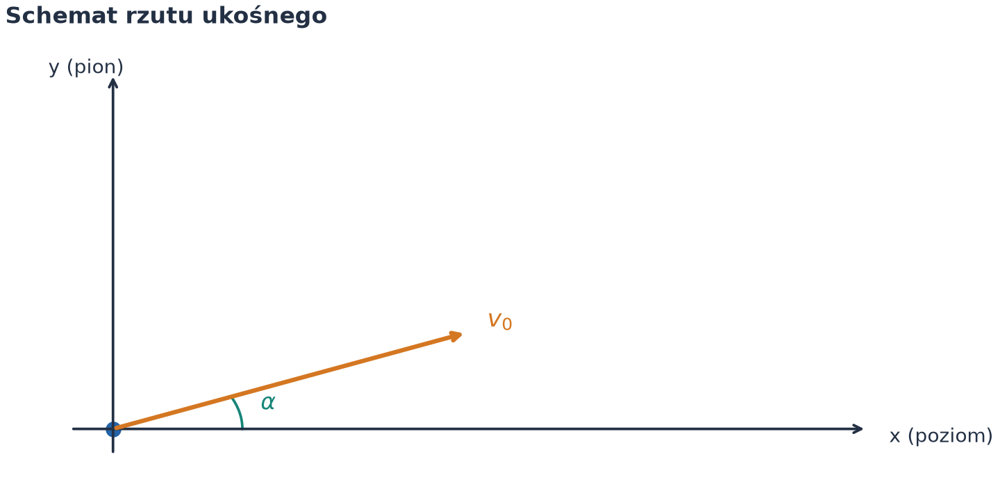

# Rzut ukośny w polu grawitacyjnym — model idealny oraz z uwzględnieniem oporu powietrza

*Raport obliczeniowy i analiza fizyczna z wykorzystaniem środowiska Python i formatu Markdown.*

**Temat:** Dwuwymiarowy ruch punktu materialnego w jednorodnym polu grawitacyjnym.  
**Metoda:** Analityczne rozwiązania równań różniczkowych (model idealny) oraz całkowanie numeryczne algorytmem Rungego-Kutty (model z oporem powietrza).  
**Charakter danych:** Dane symulacyjne wygenerowane na podstawie parametrów początkowych.

---

## Spis treści

1. [Cel i model fizyczny](#1-cel-i-model-fizyczny)
2. [Rzut ukośny bez oporu powietrza (model idealny)](#2-rzut-ukośny-bez-oporu-powietrza-model-idealny)
3. [Analiza parametrów lotu i dynamiki energii](#3-analiza-parametrów-lotu-i-dynamiki-energii)
4. [Rzut ukośny z oporem powietrza (opór liniowy)](#4-rzut-ukośny-z-oporem-powietrza-opór-liniowy)
5. [Porównanie modeli i analiza dysypacji energii](#5-porównanie-modeli-i-analiza-dysypacji-energii)
6. [Kod i odtwarzanie wykresów](#6-kod-i-odtwarzanie-wykresów)
7. [Wnioski](#7-wnioski)

---

## 1. Cel i model fizyczny

Rzut ukośny jest klasycznym przykładem dwuwymiarowego ruchu ciała poddanego działaniu stałej siły ciężkości. Analiza tego ruchu stanowi fundament dynamiki punktu materialnego.

Celem raportu jest pełne wyprowadzenie równań opisujących położenie, prędkość i energię ciała w rzucie ukośnym, a także zbadanie wpływu oporu lepkiego ośrodka na zasięg i czas lotu.

### 1.1. Założenia przyjęte do modelu

- Ciało traktujemy jako punkt materialny o masie $m$.
- Pole grawitacyjne jest jednorodne, a przyspieszenie ziemskie wynosi $g = 9{,}81\,\mathrm{m/s^2}$.
- Pomijamy siłę Coriolisa oraz zmianę gęstości powietrza z wysokością.
- W modelu tłumionym siła oporu powietrza jest wprost proporcjonalna do prędkości: $\vec{F}_{\mathrm{op}} = -b\vec{v}$.



*Rysunek 1. Schemat układu współrzędnych, kąta wyrzutu $\alpha$ oraz wektora prędkości początkowej $\vec{v}_0$.*

### 1.2. Wartości parametrów wejściowych

Zgodnie z wytycznymi, prędkość początkowa $v_0$ oraz kąt $\alpha$ wynikają z cyfr numeru indeksu:

| Parameter | Symbol | Wartość | Jednostka SI |
| :--- | :---: | ---: | :---: |
| Prędkość początkowa | $v_0$ | $12{,}0$ | $\mathrm{m/s}$ |
| Kąt wyrzutu | $\alpha$ | $45{,}0^\circ$ | $\mathrm{rad}$ ($0{,}7854\,\mathrm{rad}$) |
| Przyspieszenie ziemskie | $g$ | $9{,}81$ | $\mathrm{m/s^2}$ |
| Masa ciała | $m$ | $1{,}0$ | $\mathrm{kg}$ |
| Współczynnik oporu lepkiego | $b$ | $0{,}15$ | $\mathrm{N\,s/m}$ |

---

## 2. Rzut ukośny bez oporu powietrza (model idealny)

### 2.1. Wyprowadzenie równań ruchu

Na ciało działa jedynie siła ciężkości $\vec{F} = (0, -mg)$. Z II zasady dynamiki Newtona:

$$
m \frac{d^2 x}{dt^2} = 0, \qquad m \frac{d^2 y}{dt^2} = -mg.
$$

Po uproszczeniu przez masę $m$ otrzymujemy układ równań przyspieszeń:

$$
\ddot{x}(t) = 0, \qquad \ddot{y}(t) = -g.
$$

Całkując raz po czasie z warunkami początkowymi $v_x(0) = v_0 \cos\alpha$ oraz $v_y(0) = v_0 \sin\alpha$:

$$
v_x(t) = v_0 \cos\alpha, \qquad v_y(t) = v_0 \sin\alpha - gt.
$$

Kolejne całkowanie z warunkami $x(0) = 0$, $y(0) = 0$ daje równania położenia:

$$
x(t) = (v_0 \cos\alpha) t,
$$

$$
y(t) = (v_0 \sin\alpha) t - \frac{1}{2}gt^2.
$$

### 2.2. Równanie trajektorii $y(x)$

Wyznaczając czas $t = \frac{x}{v_0 \cos\alpha}$ z równania na $x(t)$ i podstawiając do $y(t)$, uzyskujemy równanie paraboli:

$$
y(x) = x \operatorname{tg}\alpha - \frac{g}{2 v_0^2 \cos^2\alpha} x^2.
$$


*Rysunek 2. Paraboliska trajektoria rzutu ukośnego w warunkach idealnych (bez oporu powietrza).*

---

## 3. Analiza parametrów lotu i dynamiki energii

### 3.1. Kluczowe parametry rzutu

1. **Czas lotu ($t_c$):** warunek $y(t_c) = 0$ dla $t_c > 0$:

$$
t_c = \frac{2 v_0 \sin\alpha}{g}.
$$

2. **Maksymalna wysokość ($h_{\max}$):** warunek $v_y(t_h) = 0 \implies t_h = \frac{t_c}{2}$:

$$
h_{\max} = y(t_h) = \frac{v_0^2 \sin^2\alpha}{2g}.
$$

3. **Zasięg rzutu ($Z$):** podstawienie $t_c$ do równania $x(t)$:

$$
Z = x(t_c) = \frac{v_0^2 \sin(2\alpha)}{g}.
$$

Dla przyjętych danych liczbowych ($v_0 = 12\,\mathrm{m/s}$, $\alpha = 45^\circ$):

| Wielkość fizyczna | Wzór | Wartość obliczona |
| :--- | :---: | ---: |
| Czas lotu | $t_c$ | $1{,}729\,\mathrm{s}$ |
| Maksymalna wysokość | $h_{\max}$ | $3{,}670\,\mathrm{m}$ |
| Zasięg rzutu | $Z$ | $14{,}679\,\mathrm{m}$ |


*Rysunek 3. Zmiana składowych prędkości $v_x, v_y$ oraz całkowitej szybkości $v(t)$ w czasie.*

### 3.2. Zachowanie energii mechanicznej

Energia kinetyczna $E_k$, potencjalna $E_p$ oraz całkowita $E_c$ wynoszą odpowiednio:

$$
E_k(t) = \frac{1}{2}m (v_x^2 + v_y^2), \qquad E_p(t) = mgy(t), \qquad E_c = E_k + E_p = \frac{1}{2}m v_0^2 = \mathrm{const}.
$$


*Rysunek 4. Wzajemna konwersja energii kinetycznej i potencjalnej w trakcie rzutu bez oporów.*

---

## 4. Rzut ukośny z oporem powietrza (opór liniowy)

Gdy na ciało działa siła oporu lepkiego $\vec{F}_{\mathrm{op}} = -b\vec{v}$, wektorowe równanie ruchu przyjmuje postać:

$$
m \frac{d\vec{v}}{dt} = m\vec{g} - b\vec{v}.
$$

W rozbiciu na składowe:

$$
\dot{v}_x + \gamma v_x = 0, \qquad \dot{v}_y + \gamma v_y = -g, \qquad \gamma = \frac{b}{m}.
$$

Rozwiązania analityczne dla prędkości:

$$
v_x(t) = v_0 \cos\alpha \, e^{-\gamma t},
$$

$$
v_y(t) = \left(v_0 \sin\alpha + \frac{g}{\gamma}\right) e^{-\gamma t} - \frac{g}{\gamma}.
$$

Po scałkowaniu otrzymujemy położenia w czasie:

$$
x(t) = \frac{v_0 \cos\alpha}{\gamma} \left(1 - e^{-\gamma t}\right),
$$

$$
y(t) = \frac{1}{\gamma} \left(v_0 \sin\alpha + \frac{g}{\gamma}\right) \left(1 - e^{-\gamma t}\right) - \frac{g}{\gamma} t.
$$

---

## 5. Porównanie modeli i analiza dysypacji energii

Wprowadzenie oporu powietrza zmienia trajektorię ze symetrycznej paraboli na krzywą asymetryczną, opadającą bardziej stromo w końcowej fazie ruchu.


*Rysunek 5. Porównanie trajektorii rzutu w próżni oraz z oporem powietrza ($b=0{,}15\,\mathrm{N s/m}$).*

Praca wykonywana przez siłę oporu powoduje nieodwracalną dysypację energii mechanicznej na energię wewnętrzną ośrodka:

$$
\frac{dE_c}{dt} = \vec{F}_{\mathrm{op}} \cdot \vec{v} = -b v^2 \le 0.
$$


*Rysunek 6. Spadek energii całkowitej układu w czasie na skutek obecności oporu lepkiego.*

Ponadto, kąt zapewniający optymalny zasięg w próżni wynosi dokładnie $\alpha = 45^\circ$, podczas gdy obecność oporu przesuwa optymalny kąt wyrzutu ku niższym wartościom.


*Rysunek 7. Trajektorie rzutu dla różnych kątów wyrzutu $\alpha$.*

---

## 6. Kod i odtwarzanie wykresów

Wszystkie rysunki zamieszczone w niniejszym raporcie zostały wygenerowane automatycznie przy użyciu języka Python.

Kod źródłowy znajduje się w pliku `generuj_wykresy.py`. Aby odtworzyć obliczenia lokalnie w VS Code:

```bash
pip install numpy matplotlib scipy
python generuj_wykresy.py
```

---

## 7. Wnioski

1. Rzut ukośny w warunkach idealnych charakteryzuje się symetryczną trajektorią paraboliczną oraz ścisłym spełnieniem zasady zachowania energii mechanicznej.
2. Zasięg maksymalny w próżni osiągany jest dla kąta wyrzutu $\alpha = 45^\circ$.
3. Uwzględnienie oporu powietrza powoduje asymetrię trajektorii, zmniejszenie zasięgu oraz maksymalnej wysokości lotu.
4. Energia mechaniczna w modelu tłumionym maleje monotonicznie z szybkością proporcjonalną do kwadratu prędkości ($b v^2$).


## 8. Kod do generowania wykresów

```
from pathlib import Path
import numpy as np
import matplotlib.pyplot as plt
from scipy.integrate import solve_ivp

# --- KONFIGURACJA DANYCH Z INDEKSU ---
INDEX_FIRST_TWO = 33  # Podmień na 2 pierwsze cyfry swojego indeksu
INDEX_LAST_TWO = 24   # Podmień na 2 ostatnie cyfry swojego indeksu

v0 = float(INDEX_FIRST_TWO)
alpha_deg = float(INDEX_LAST_TWO)
alpha_rad = np.radians(alpha_deg)
g = 9.81
m = 1.0       # masa [kg]
b = 0.15      # współczynnik oporu powietrza [kg/s]

OUT = Path("files/rzut_ukosny")
OUT.mkdir(parents=True, exist_ok=True)

# Styl wykresów spójny z przykładowym raportem
INK = "#233044"
BLUE, ORANGE, GREEN, PURPLE = "#2463A6", "#D47722", "#168578", "#8455A4"

plt.rcParams.update({
    "font.family": "DejaVu Sans", "font.size": 11,
    "axes.titlesize": 13, "axes.titleweight": "bold",
    "axes.labelcolor": INK, "text.color": INK,
    "axes.spines.top": False, "axes.spines.right": False,
    "axes.grid": True, "grid.alpha": 0.18,
    "lines.linewidth": 2.3, "figure.facecolor": "white",
    "savefig.facecolor": "white",
})

def zapisz(fig, nazwa):
    fig.savefig(OUT / f"{nazwa}.png", dpi=180)
    plt.close(fig)

# --- 1. SCHEMAT FIZYCZNY ---
fig, ax = plt.subplots(figsize=(8, 4), layout="constrained")
ax.set(xlim=(-0.5, 4), ylim=(-0.5, 3))
ax.axis("off")
ax.annotate("", xy=(3.5, 0), xytext=(-0.2, 0), arrowprops=dict(arrowstyle="->", lw=1.5, color=INK))
ax.annotate("", xy=(0, 2.7), xytext=(0, -0.2), arrowprops=dict(arrowstyle="->", lw=1.5, color=INK))
ax.text(3.6, -0.1, "x (poziom)", fontsize=11)
ax.text(-0.3, 2.7, "y (pion)", fontsize=11)
ax.plot(0, 0, 'o', color=BLUE, ms=8)
ax.annotate("", xy=(1.8*np.cos(alpha_rad), 1.8*np.sin(alpha_rad)), xytext=(0, 0),
            arrowprops=dict(arrowstyle="->", lw=2.5, color=ORANGE))
ax.text(1.9*np.cos(alpha_rad), 1.9*np.sin(alpha_rad), r"$v_0$", color=ORANGE, fontsize=14, weight="bold")
arc = np.linspace(0, alpha_rad, 50)
ax.plot(0.6*np.cos(arc), 0.6*np.sin(arc), color=GREEN, lw=1.5)
ax.text(0.7*np.cos(alpha_rad/2), 0.7*np.sin(alpha_rad/2), r"$\alpha$", color=GREEN, fontsize=13)
ax.set_title("Schemat rzutu ukośnego", loc="left")
zapisz(fig, "schemat")

# --- 2. SOLVER NUMERYCZNY DLA OBU MODELI ---
# Bez oporu (analitycznie)
t_fly_bez = 2 * v0 * np.sin(alpha_rad) / g
t_bez = np.linspace(0, t_fly_bez, 500)
x_bez = v0 * np.cos(alpha_rad) * t_bez
y_bez = v0 * np.sin(alpha_rad) * t_bez - 0.5 * g * t_bez**2
vx_bez = np.full_like(t_bez, v0 * np.cos(alpha_rad))
vy_bez = v0 * np.sin(alpha_rad) - g * t_bez

# Z oporem (numerycznie)
def rhs(t, s):
    x, y, vx, vy = s
    v = np.hypot(vx, vy)
    return [vx, vy, -(b/m)*vx, -g - (b/m)*vy]

def hit_ground(t, s):
    return s[1]
hit_ground.terminal = True
hit_ground.direction = -1

sol = solve_ivp(rhs, (0, 100), [0, 0, v0*np.cos(alpha_rad), v0*np.sin(alpha_rad)],
                events=hit_ground, rtol=1e-9, atol=1e-9, max_step=0.01)

t_z = sol.t
x_z, y_z, vx_z, vy_z = sol.y

# --- 3. TRAJEKTORIA PORÓWNANIE ---
fig, ax = plt.subplots(figsize=(9, 4.5), layout="constrained")
ax.plot(x_bez, y_bez, color=BLUE, label="Bez oporu (idealny)")
ax.plot(x_z, y_z, color=ORANGE, ls="--", label=f"Z oporem powietrza (b = {b} kg/s)")
ax.set(xlabel="Odległość x [m]", ylabel="Wysokość y [m]", title="Trajektoria ruchu w rzucie ukośnym")
ax.legend()
zapisz(fig, "trajektoria_porownanie")

# --- 4. PRĘDKOŚĆ W FUNKCJI CZASU ---
fig, axes = plt.subplots(2, 1, figsize=(9, 6), sharex=True, layout="constrained")
axes[0].plot(t_bez, vx_bez, color=BLUE, label="$v_x$ bez oporu")
axes[0].plot(t_z, vx_z, color=ORANGE, ls="--", label="$v_x$ z oporem")
axes[0].set_ylabel("Prędkość $v_x$ [m/s]")
axes[0].legend()

axes[1].plot(t_bez, vy_bez, color=BLUE, label="$v_y$ bez oporu")
axes[1].plot(t_z, vy_z, color=ORANGE, ls="--", label="$v_y$ z oporem")
axes[1].set(xlabel="Czas t [s]", ylabel="Prędkość $v_y$ [m/s]")
axes[1].legend()
axes[0].set_title("Składowe prędkości w czasie", loc="left")
zapisz(fig, "predkosc_czas")

# --- 5. ENERGIA W FUNKCJI CZASU ---
Ek_bez = 0.5 * m * (vx_bez**2 + vy_bez**2)
Ep_bez = m * g * y_bez
E_bez = Ek_bez + Ep_bez

Ek_z = 0.5 * m * (vx_z**2 + vy_z**2)
Ep_z = m * g * y_z
E_z = Ek_z + Ep_z

fig, ax = plt.subplots(figsize=(9, 4.5), layout="constrained")
ax.plot(t_bez, E_bez, color=BLUE, label="Całkowita (bez oporu)")
ax.plot(t_z, E_z, color=ORANGE, ls="--", label="Całkowita (z oporem)")
ax.plot(t_z, Ek_z, color=GREEN, ls=":", label="Kinetyczna (z oporem)")
ax.plot(t_z, Ep_z, color=PURPLE, ls=":", label="Potencjalna (z oporem)")
ax.set(xlabel="Czas t [s]", ylabel="Energia [J]", title="Bilans energii mechanicznej")
ax.legend()
zapisz(fig, "energia_czas")

# --- 6. PRZESTRZEŃ FAZOWA (y vs vy) ---
fig, ax = plt.subplots(figsize=(8, 4.5), layout="constrained")
ax.plot(y_bez, vy_bez, color=BLUE, label="Bez oporu")
ax.plot(y_z, vy_z, color=ORANGE, ls="--", label="Z oporem")
ax.set(xlabel="Wysokość y [m]", ylabel="Prędkość pionowa $v_y$ [m/s]", title="Portret fazowy w osi pionowej (y, v_y)")
ax.legend()
zapisz(fig, "przestrzen_fazowa")

# --- 7. WPŁYW WSPÓŁCZYNNIKA OPORU b ---
fig, ax = plt.subplots(figsize=(9, 4.5), layout="constrained")
ax.plot(x_bez, y_bez, color=BLUE, label="b = 0 (bez oporu)")
for b_val, color in zip([0.05, 0.15, 0.30], [GREEN, ORANGE, PURPLE]):
    sol_b = solve_ivp(lambda t, s: [s[2], s[3], -(b_val/m)*s[2], -g - (b_val/m)*s[3]],
                      (0, 100), [0, 0, v0*np.cos(alpha_rad), v0*np.sin(alpha_rad)],
                      events=hit_ground, max_step=0.01)
    ax.plot(sol_b.y[0], sol_b.y[1], color=color, ls="--", label=f"b = {b_val} kg/s")
ax.set(xlabel="Odległość x [m]", ylabel="Wysokość y [m]", title="Wpływ współczynnika oporu powietrza b na zasięg")
ax.legend()
zapisz(fig, "wplyw_b")

print("Wykresy zostały pomyślnie wygenerowane w katalogu files/rzut_ukosny/")
```